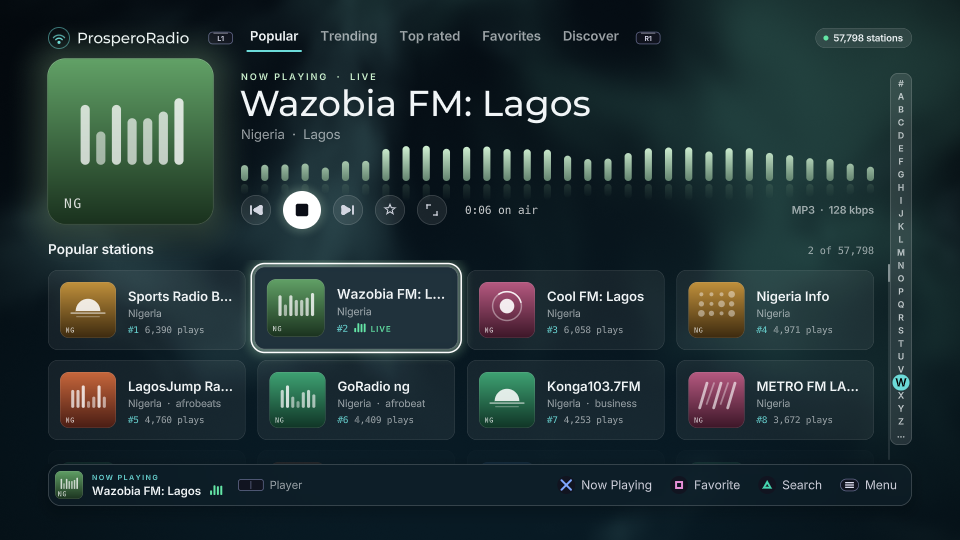

<p align="center">
  
</p>

<h1 align="center">ProsperoRadio</h1>

<p align="center">
  <strong>A native Internet-radio application for PlayStation 5 homebrew</strong><br>
  Browse and search the Radio Browser catalogue with resilient disk-backed
  caching, native PS5 audio playback, and a controller-first OpenGL interface.
</p>

<p align="center">
  <a href="https://github.com/bornaradusin/ProsperoRadio/actions/workflows/tooling.yml"></a>
  <a href="https://github.com/bornaradusin/ProsperoRadio/releases/latest"></a>
  <a href="LICENSE"></a>
</p>

<p align="center">
  <a href="https://www.buymeacoffee.com/bornaradusin">
    
  </a>
</p>
## Project preservation and maintenance

**ProsperoRadio was originally created and developed by BlackBearReloaded.**

This repository is a continuation of the original ProsperoRadio project, established to preserve the application and its source code after the original GitHub repository became unavailable.

The goal is to keep ProsperoRadio accessible, working and available for future development on PlayStation 5 homebrew systems.

**Original developer:** BlackBearReloaded  
**Current maintainer:** [bornaradusin](https://github.com/bornaradusin)

All original copyright notices, third-party acknowledgements and GPL-3.0-or-later licensing are retained. Credit for the original application and its development belongs to BlackBearReloaded.



**Project maintenance:** Originally created by **BlackBearReloaded**, who has stepped down. **[bornaradusin](https://github.com/bornaradusin)** now develops and maintains ProsperoRadio. Original copyright and licences are preserved.

## Features

- Browse Popular, Trending, Top rated, Favorites, and Discover views.
- Search live Radio Browser data by text, country, genre, language, and
  bitrate, with mirror failover and server-side paging.
- Keep a large SQLite catalogue and favourites on `/data/prosperoradio`; a failed sync
  leaves the last verified catalogue untouched.
- Navigate entirely with the DualSense D-pad or left analogue stick; the PS5
  IME handles text entry.
- Draw station names in every script (Arabic, Cyrillic, Chinese, Persian and
  more) with the console's own fonts, HarfBuzz shaping and right-to-left
  ordering.
- Keep everything it writes in one place outside the app folder,
  `/data/prosperoradio`, so an update never touches it. See
  [Where ProsperoRadio keeps its files](#where-prosperoradio-keeps-its-files).
- Play AAC/AAC+ and MP3 through native PS5 decoding; play Opus through the
  native Opus/CELT decoder route; play Vorbis and FLAC/Ogg-FLAC with bounded
  CPU decoders.
- Resolve bounded M3U/PLS indirection, strip ICY metadata, and support the
  audio-only AAC HLS subset.

App-specific codec limits and validation are documented in
[Architecture](docs/ARCHITECTURE.md),
[Codec investigation](docs/CODEC_INVESTIGATION.md), and
[Roadmap](ROADMAP.md).

## App details

| Identity | Value |
| --- | --- |
| Shell title | `ProsperoRadio` |
| Title ID | `PPSA99001` |
| Category | Media |
| Current release version | `01.000.010` |
| Release-version source | [`sce_sys/param.json`](sce_sys/param.json) |
| Writable data | `/data/prosperoradio` |

## Installation and updates

1. Fully close ProsperoRadio.
2. From the
   [latest release](https://github.com/bornaradusin/ProsperoRadio/releases/latest),
   download `PPSA99001.zip`.
3. Extract it locally, then upload the entire `PPSA99001/` folder over FTP so
   its destination is `/data/homebrew/PPSA99001/`, and wait for the transfer to
   finish. Do not upload the ZIP file itself.
4. If an earlier release was installed as `/data/homebrew/PPSA99001.ffpfsc`,
   remove that image: do not keep it beside the folder. Restart ShadowMountPlus
   cleanly or restart the PS5.
5. Start the approved services normally, wait for ShadowMountPlus to
   rediscover `PPSA99001`, then launch ProsperoRadio and confirm the version
   shown below the app name.

Do not relaunch immediately after replacing the app: ShadowMountPlus may
still have the previous folder mounted. The catalogue, favourites
and settings are in `/data/prosperoradio`, outside the app, so they are kept;
Shell presentation metadata may remain cached.

Automatic-update compatibility with [Prospero Store](https://prosperostore.net/) has not been verified. For updates, use GitHub Releases.

## Where ProsperoRadio keeps its files

The app itself stays in `/data/homebrew/PPSA99001` (or wherever ShadowMountPlus
mounts it from). Everything it writes is in `/data/prosperoradio`:

```text
/data/prosperoradio/
├── config/     settings.txt, the favourites, the update check's sequence number
├── catalog/    the station catalogue (rebuilt by a refresh)
└── logs/       Application logs
```

Favourites and the catalogue an earlier version kept in its sandbox are copied
over on the first start. Without filesystem access (no resident Lapy service
and no ELF loader on port 9021) the same files stay in the title's sandbox,
`/download0`, as in release 01.000.005.

## Requirements

Build from Linux, WSL, or a Linux CI runner. On Ubuntu, Debian, or WSL:

```bash
sudo apt update
sudo apt install curl git make pkg-config python3 python3-venv tar unzip wget zip \
  clang-18 clang-format-18 clang-tidy-18 lld-18 libsqlite3-dev
```

The
repository downloads, verifies, and caches the public PS5 Payload SDK, zlib,
PacBrew's SQLite and libcurl ports, the interface kit, the ps5-opengl SDK,
HarfBuzz, the pinned upstream Lapy helper sources, and GoogleTest
below ignored `.deps/`.
No proprietary SDK, system module, key, or game asset is included or fetched.

## Build

`sce_sys/param.json` is the only identity and release-version source. Do not
change `PPSA99001` when updating ProsperoRadio: changing it produces a separate PS5
title rather than an update.

```bash
make app
```

The output is the complete title folder:

```text
dist/PPSA99001/
```

## Tests

```bash
make test            # C++ unit tests, UI/metadata tests, 16 codec/catalogue checks
make lint            # formatting, static analysis, metadata, and shell checks
make check           # lint + all host tests + complete folder build
```

The test suite runs entirely on the host and never contacts a console. It
covers RML/UI asset consistency, catalogue persistence, mirror/query parsing,
AAC timing, MP3 framing, ICY metadata, PCM/retry behaviour, Ogg/Opus,
Vorbis, FLAC, HLS/MPEG-TS, controller input, and Arabic/RTL text ordering.
The PS5-only boundary is documented in [Testing](docs/TESTING.md).

## Credits and licence

Original developer: **BlackBearReloaded**. Current developer and maintainer: **bornaradusin**. Copyright 2026 BlackBearReloaded. GPL-3.0-or-later; see [LICENSE](LICENSE) and [third-party notices](THIRD_PARTY_NOTICES.md).
